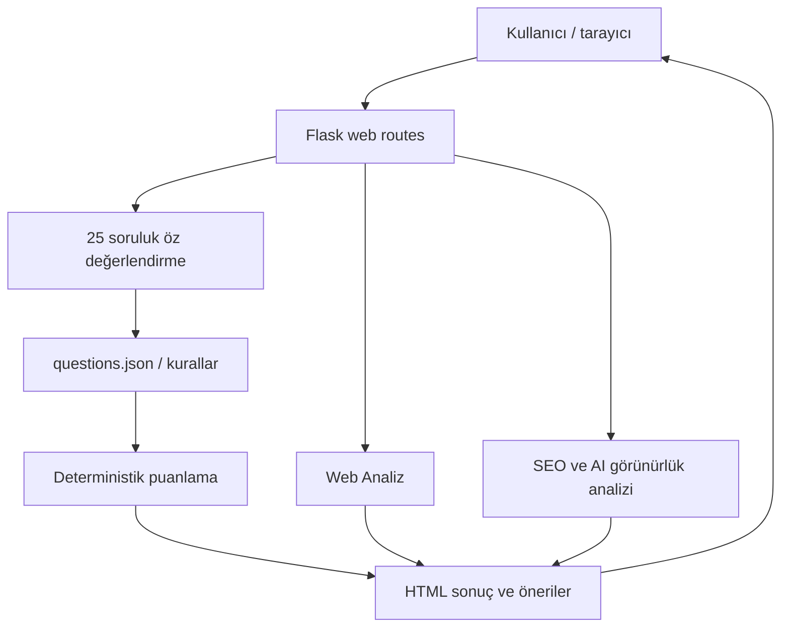

# SiberKOBİ

SiberKOBİ, KOBİ'lerin temel siber güvenlik kontrollerini kendi kendilerine değerlendirebilmesi için geliştirilen ücretsiz ve açık kaynak bir öz değerlendirme aracıdır.

## Özellikler

- 25 teknik soru (SK-T01–SK-T25)
- 5 güvenlik alanı
- Evet / Kısmen / Hayır yanıtları
- Yalnız uygun sorularda Uygulanamaz seçeneği
- Deterministik değerlendirme
- Alan bazlı sonuçlar
- HTML sonuç ve iyileştirme raporu
- SEO analizinde GPTBot, OAI-SearchBot, Googlebot ve Bingbot robots.txt erişim kontrolü
- Temel AI görünürlük skoru, JSON-LD ve semantik içerik okunabilirliği kontrolü
- İsteğe bağlı llms.txt varlık kontrolü (skoru etkilemez; zorunlu web standardı olarak değerlendirilmez)
- Tarayıcı üzerinden yazdırma / PDF olarak kaydetme
- Kullanıcı hesabı ve veritabanı gerektirmeyen yapı
- Kalıcı değerlendirme geçmişi veya sunucu tarafı rapor arşivi yok
- Kullanım öncesi zorunlu yetki/sorumluluk onayı
- Docker ile kolay kurulum
- Modüler Flask mimarisi

## Mimari ve veri akışı



Uygulama GitHub Pages üzerinde statik JSON yayımlayan bir servis değildir. Flask ve Gunicorn ile Docker veya Python ortamında çalışır; kullanıcıya raporu HTTP üzerinden sunar. Web Analiz ve SEO Analiz, açık yetki onayının ardından kontrollü dış ağ istekleri gerçekleştirebilir. Mimari ayrıntılar [docs/ARCHITECTURE.md](docs/ARCHITECTURE.md) içinde yer alır.

## Veri saklama yaklaşımı

SiberKOBİ varsayılan olarak stateless çalışır.

- Değerlendirme yanıtları kalıcı olarak saklanmaz.
- Geçmiş değerlendirme listesi oluşturulmaz.
- Sunucuda HTML/PDF rapor arşivi tutulmaz.
- Flask session kullanılmaz ve değerlendirme sonucu için session cookie oluşturulmaz.
- Sonuç yanıtları `Cache-Control: no-store` ile döner.
- Operasyonel loglar form yanıtlarını kaydetmez.

Kullanıcı isterse sonuç ekranını tarayıcı üzerinden yazdırabilir veya kendi cihazına PDF olarak kaydedebilir.

## Kullanım onayı

Değerlendirme tamamlanmadan önce kullanıcı, aracı kendi kurumu, sistemleri veya değerlendirme yapmaya açıkça yetkili olduğu bir ortam için kullandığını onaylamalıdır.

Onay verilmeden gönderim butonu aktif olmaz ve backend de aynı onayı ayrıca doğrular.

## Hızlı başlangıç — Docker

```bash
git clone https://github.com/YagmurEr/siberkobi.git
cd siberkobi
docker compose up --build
```

Ardından:

```text
http://localhost:8000
```

Health endpoint:

```text
http://localhost:8000/health
```

## Python ile çalıştırma

Python 3.13 veya üzeri:

```bash
python -m venv .venv
source .venv/bin/activate
pip install .
flask --app app:create_app run
```

Windows PowerShell:

```powershell
python -m venv .venv
.\.venv\Scripts\Activate.ps1
pip install .
flask --app app:create_app run
```

Ayrıntılı dağıtım seçenekleri için `docs/DISTRIBUTION.md`, canlı ortam
operasyonu için `docs/DEPLOYMENT.md`, Web/SEO Analiz ağ kapsamı için
`docs/SCAN_SCOPE.md` dosyalarına bakın.

## Geliştirme ortamı

```bash
pip install -e ".[dev]"
ruff check .
pytest -q
python scripts/validate_json.py
bandit -r app
pip-audit
python -m build
```

Bu kontroller ve Docker image build doğrulaması GitHub Actions üzerinde çalıştırılır.

## Mimari ilkeler

- Eclipta Suite kaynak kodu kullanılmaz veya kopyalanmaz.
- Sorular ve değerlendirme kuralları uygulama kodundan ayrıdır.
- Harici AI sağlayıcısı, API anahtarı veya kullanıcı hesabı gereksinimi yoktur.
- Web Analiz ve SEO Analiz, kullanıcının yetki onayıyla dış hedeflere sınırlı
  ağ istekleri gönderir; kapsam `docs/SCAN_SCOPE.md` içinde belgelenmiştir.
- Kalıcı kullanıcı verisi tutulmaz.
- Güvenli varsayılanlar, test edilebilirlik ve anlamlı loglama temel gereksinimdir.

## Proje yapısı

```text
app/
  assessment/
  evaluation/
  reporting/
  config/
  web/
  templates/
  static/
tests/
docs/
.github/workflows/
Dockerfile
compose.yaml
```

## Değerlendirme

Puanlama ve sonuç bantları `docs/ARCHITECTURE.md` içinde belgelenmiştir.

## Dağıtım

SiberKOBİ; Docker/Compose, doğrudan Python kurulumu ve GitHub release kaynak arşivleriyle dağıtılabilir. CI, Python wheel paketinin gerekli JSON/template/static dosyalarını içerdiğini doğrular.

Kullanıcıyı etkileyen değişiklikler `CHANGELOG.md` dosyasında izlenir.

## Lisans

SiberKOBİ MIT License altında yayımlanır. Ayrıntılar için `LICENSE` dosyasına bakın.

## Katkı ve güvenlik

Katkı kuralları [CONTRIBUTING.md](CONTRIBUTING.md), güvenlik bildirim süreci [SECURITY.md](SECURITY.md) dosyasındadır. GitHub Actions her PR için lint, test, veri sözleşmesi, bağımlılık denetimi, paket ve Docker doğrulamalarını çalıştırır. Dependabot Python ve GitHub Actions bağımlılıklarını haftalık kontrol eder.
